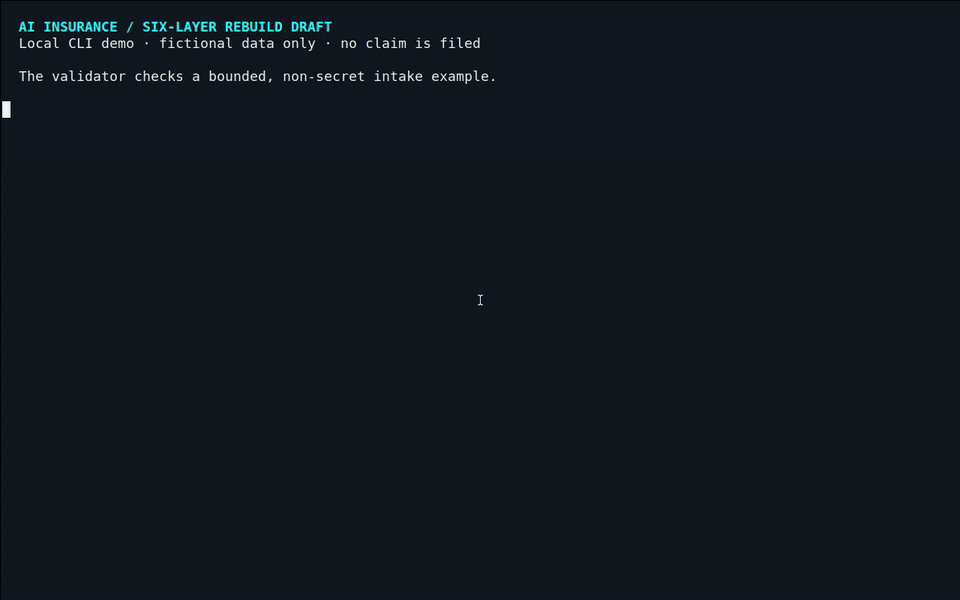
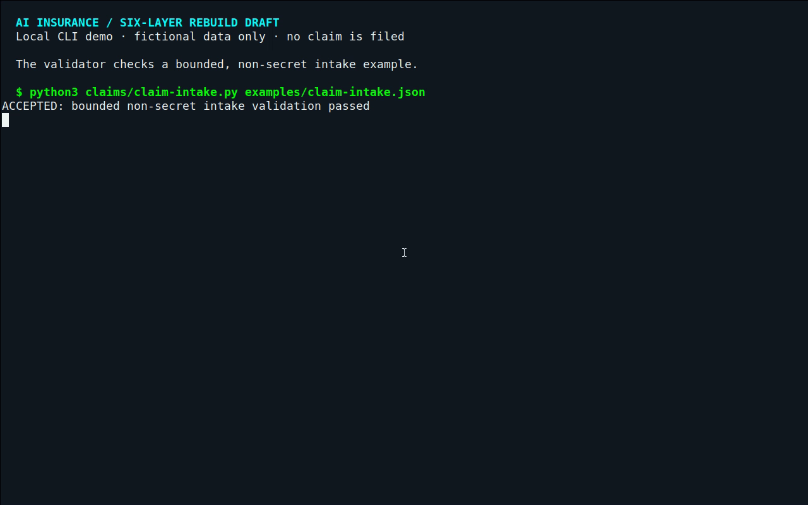
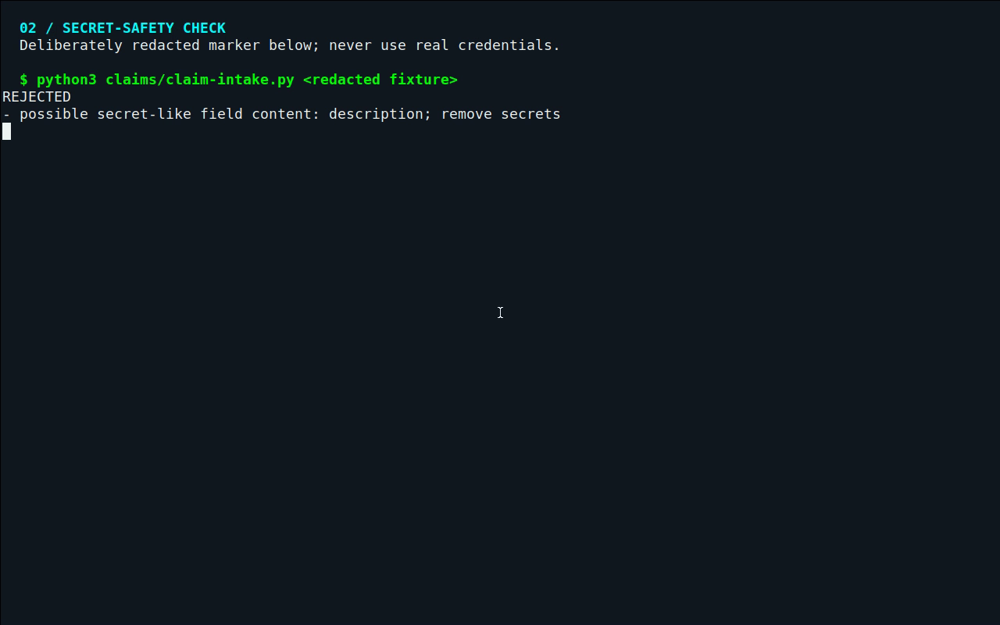
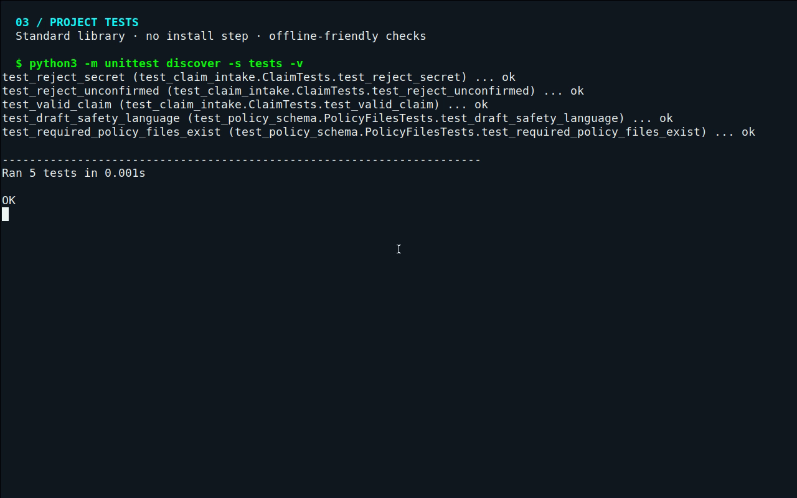

# AI Insurance

**A draft toolkit for planning a customer-controlled AI-workspace rebuild—without handing over credentials.**

> **Draft only.** This is not an insurance policy, recovery service, warranty, or offer for sale. No live demo is published.

*One checklist. Six layers. No magic-wand promises.*

## Why this exists

When an AI workspace breaks, the recovery work can be scattered across memory exports, project files, handoff notes, account reconnections, integrations, and scheduled jobs. It is hard to see what can be rebuilt, what needs a person to reconnect, and what may be gone for good.

This repository organizes that work into six layers and a repeatable sequence: **Package → Import → Reconnect → Schedule → Prove**. It is for people documenting a careful rebuild—not software that restores an AI setup for you. The customer keeps control of their host, files, accounts, and credentials; the templates do not promise that deleted data or unsupported integrations can be recovered.

## See it work

**Live demo:** unavailable—the project is unpublished and nothing has been deployed.

The fastest runnable demo is the local JSON validator. This real terminal recording shows a fictional example accepted, a deliberately redacted secret-like string rejected, and the test suite run:



```bash
python3 claims/claim-intake.py examples/claim-intake.json
```

That command checks the shape and bounds of a fictional, non-secret example; it does **not** file or approve a claim. [Open the runnable example](examples/claim-intake.json) or the [fictional “bricked agent” scenario](claims/sample-claims/bricked-agent.md).

## Quick start

Python 3.12 is used in CI. The scripts use the standard library; there is no package-install step.

```bash
# install: no third-party packages needed

# validate the fictional example
python3 claims/claim-intake.py examples/claim-intake.json

# run the tests
python3 -m unittest discover -s tests -v
```

To start the optional local portal:

```bash
python3 portal/app/app.py
# open http://127.0.0.1:8765/
```

The portal is only a local notice page. It has no claim form, submission, authentication, or persistence; nothing is filed.

## Screenshots

These are real captures of the command-line tools running in this repository—not product mockups.







## What is in the repository

- [`claims/claim-intake.py`](claims/claim-intake.py) — bounded local JSON validation; it reads a file and prints a result, but does not submit or store claims.
- [`offer/six-layers.md`](offer/six-layers.md) — the six-layer model and rebuild sequence.
- [`claims/sample-claims/`](claims/sample-claims/) — fictional incident examples; [`bricked-agent.md`](claims/sample-claims/bricked-agent.md) is the quickest read.
- [`policy/`](policy/) and [`legal/`](legal/) — unfinished review templates, not approved policy or legal terms.
- [`pricing/`](pricing/) — draft arithmetic and assumptions, not a quote or approved price.
- [`site/`](site/) — a separate, no-index static concept page.

## Important limits

This repository is a draft software/template artifact—not legal advice, insurance, a warranty, or a recovery promise. The word “insurance,” pricing, coverage, guarantees, refunds, and claims handling need qualified legal, regulatory, underwriting, privacy, security, and operational review before any launch.

The validator flags some common secret-like patterns, but that is only a heuristic—not a guarantee that sensitive text will be detected. **Never use real credentials, recovery codes, or unnecessary personal information in examples or tests.** The portal has no backend, claim submission, or persistence.

The separate static page contains age-gated third-party support and payment destinations; some may lead to live provider flows. They are not part of the validator demo and have not been verified for release. Review or remove them before publishing anything.

## Hosting status

No project demo or deployment is live. [`wrangler.jsonc`](wrangler.jsonc) is prepared for Cloudflare Workers Static Assets, and [`DEPLOYMENT-DRAFT.md`](DEPLOYMENT-DRAFT.md) documents a no-build Cloudflare Pages option serving `site/`. Neither is enabled or deployed. A GitHub Pages alternative is documented, but no Pages publishing workflow is included; the existing GitHub Actions workflow runs checks only. No deployment command has been run. No license file is included, so reuse terms are unspecified.
